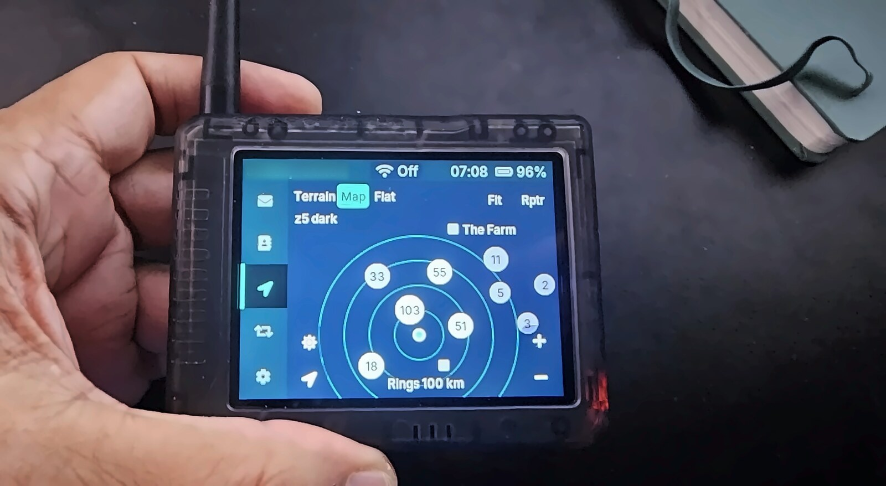
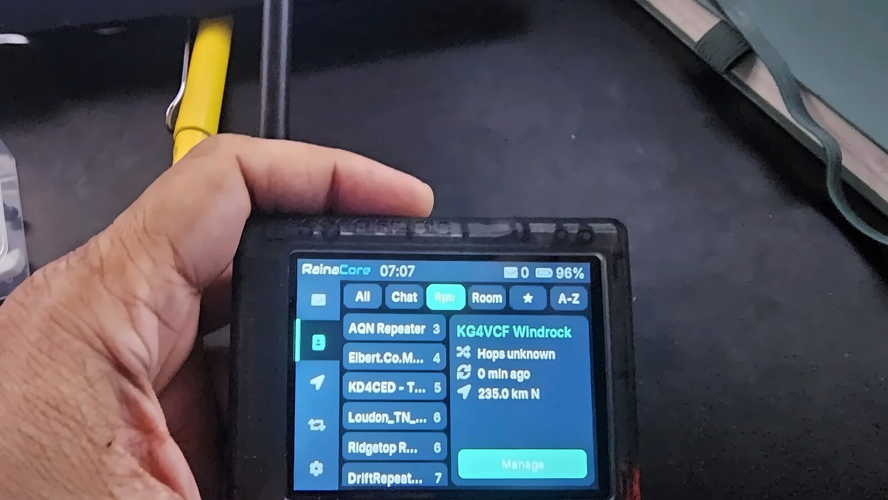
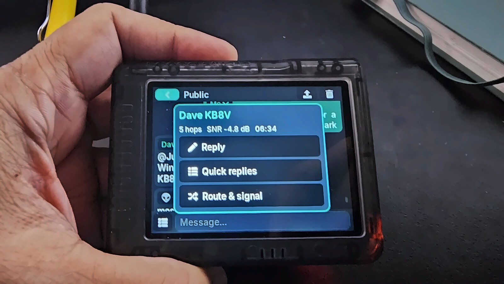

Open-source touch firmware for the **Seeed Wio Tracker L2 Pro**, with no phone
needed: chat, contacts, repeaters, channels and an offline map on the 320×240
screen.

**Compatible with MeshCore, but not connected to MeshCore development.** RainaCore
is an independent project, not affiliated with or endorsed by the MeshCore
project or Seeed Studio.

> **Beta.** Built and used on one board so far. See [Status](#status) before
> you rely on it, and [TCXO voltage](#tcxo-voltage) before you transmit.

## On the device

| Map | Repeaters | Send message |
|---|---|---|
|  |  |  |

## Features

- **Chat:** direct messages and channels with a virtual keyboard, colour emoji,
  quick replies with variables such as hop count, and a tap menu on each sender.
- **Channels:** private and public channels, joined by name or shared by QR code.
- **Contacts:** favourites and personal notes.
- **Repeaters:** a two-pane list sorted by hops, with details beside it.
- **Map:** full-screen map behind the interface, with Terrain, Map and Flat
  styles. Nearby nodes collapse into count circles; tap one to zoom in.
- **WiFi map sync:** downloads map tiles to the SD card, then switches WiFi off.
- **GPS:** sets the clock, time zone and radio region suggestion, with no
  internet needed.
- **Bot:** optional hourly test message to the `#Test` channel. Off by default.
- **Bluetooth:** optional link to the MeshCore phone app, with an off switch.

## Hardware

| | |
|---|---|
| Board | Seeed Wio Tracker L2 Pro |
| MCU | ESP32-S3, 16 MB flash, 8 MB PSRAM |
| Radio | SX1262 |
| Screen | NV3031B 320×240 with GT911 touch |
| GPS | L76K |
| Storage | microSD, needed for maps and chat history |

## Install

You need a USB-C data cable and [Python](https://www.python.org/downloads/).

1. Install esptool, version 5 or newer:

       python -m pip install --upgrade esptool

2. Download `bootloader.bin`, `partitions.bin`, `boot_app0.bin`,
   `rainacore-l2-touch-1v8-0.1.0-beta.bin` and `SHA256SUMS.txt` from
   [Releases](https://github.com/opensourcera/RainaCore/releases) into one
   folder, and check them against `SHA256SUMS.txt`.

3. Connect the board and find its port. On Windows it is listed under Ports in
   Device Manager, such as `COM19`. On Linux and macOS it looks like
   `/dev/ttyACM0`. Use your port in the commands below.

4. Open a terminal in that folder and back up your board. Keep this file private:
   it holds your device's keys and settings.

       python -m esptool --chip esp32s3 --port COM19 --baud 921600 read-flash 0 0x1000000 backup.bin

5. Install RainaCore. This is one long command, and it replaces the firmware on
   the board:

       python -m esptool --chip esp32s3 --port COM19 --baud 921600 write-flash 0x0 bootloader.bin 0x8000 partitions.bin 0xe000 boot_app0.bin 0x10000 rainacore-l2-touch-1v8-0.1.0-beta.bin

6. The board restarts into RainaCore. Set your region in the setup wizard before
   transmitting, and use only the frequencies and power allowed where you are.

If esptool cannot connect, close any other program using the port, then try
again. If that fails, put the board into bootloader mode and retry.

**To update RainaCore later,** write the firmware file only. This keeps your
contacts, keys, settings and chat history:

    python -m esptool --chip esp32s3 --port COM19 --baud 921600 write-flash 0x10000 rainacore-l2-touch-1v8-0.1.0-beta.bin

To go back, write your backup: `write-flash 0x0 backup.bin`.

## Getting a map

The firmware includes no map tiles.

1. Put a microSD card in the board.
2. Open the Map tab and choose Terrain or Map.
3. Tap **WiFi** in the top bar, or use Settings > WiFi.
4. Pick your 2.4 GHz network, enter the password, check the centre, choose an
   area and tap **Sync**.

The WiFi password is held in memory for that sync only and is never saved.
Downloads are deliberately slow and capped at 1200 tiles, to respect the free
map servers that provide them.

## Status

| Works on the test board | Not tested on hardware yet |
|---|---|
| Boot, touch UI, SD card | WiFi map sync and place names |
| Bluetooth pairing with the phone app | A real GPS fix |
| Receiving messages | Sending, and delivery receipts |
| | QR channel sharing with the phone app |
| | The four-file first install on a stock board |

Not built yet: room server chat. Rooms appear in Contacts and open the
management screen only.

## TCXO voltage

This beta is a **1.8 V build, meant for testing**. The stock firmware requests
1.8 V, so this is the expected setting, but the correct voltage for this board
is not confirmed: Meshtastic moved to 3.0 V.

On a board that needs 3.0 V, the radio may not work properly, for example weak or
failed sending and receiving. A 3.0 V build will follow if it is needed. Keep
transmit power low while testing.

`tools/l2_tcxo_check.py` reports what Meshtastic requests on a board; it is not an
electrical measurement.

## Privacy

- **Map sync** contacts `tile.openstreetmap.org` or `tile.opentopomap.org`, and
  `nominatim.openstreetmap.org` for place names. Nominatim receives the sync
  centre and up to 12 repeater positions, rounded to about 1 km.
- **Connections are not certificate-checked.** Tiles are checked as images, and
  place names are only displayed.
- **GPS log:** raw GPS sentences, which include your position, are written to
  `gps_nmea.log` on the SD card for diagnosis. Delete the file if you lend out
  the card.

## Build

Needs [PlatformIO](https://platformio.org/).

    pio run -e RainaCore_L2_1V8_touch

### Tools

| Path | What it does |
|---|---|
| `tools/pc-bench/` | Runs the real map and repeater screens on a PC with scripted touches |
| `tools/l2_tcxo_check.py` | Reads the TCXO setting Meshtastic reports at boot |
| `variants/wio-tracker-l2/tools/` | Packs and darkens map tiles on a PC |
| `examples/companion_radio/ui-lvgl/tools/` | Regenerates the emoji font and logo |

## Project layout

RainaCore is MeshCore v1.18.0 plus the changes below. The original project
README is kept as [README.MeshCore.md](README.MeshCore.md).

| Path | Contents |
|---|---|
| `examples/companion_radio/ui-lvgl/` | The touch interface |
| `variants/wio-tracker-l2/` | Board support and build settings |
| `licenses/` | Font licences |

## Credits and licences

Copyright (c) 2026 opensourcera. Released under the MIT licence, see
[license.txt](license.txt).

- [MeshCore](https://github.com/meshcore-dev/MeshCore), MIT.
- Touch UI base by plainsbuilder (MeshCore PR #3529) and Wio Tracker L2 board
  support (PR #3381), both unmerged upstream at the time of import.
- [LVGL](https://lvgl.io/), MIT.
- Inter font, SIL Open Font License 1.1, see `licenses/Inter-OFL.txt`.
- Noto Color Emoji, SIL Open Font License 1.1, see `licenses/NotoEmoji-OFL.txt`.
- Audiowide font in the logo, by Astigmatic (Brian J. Bonislawsky), SIL Open
  Font License 1.1, see `licenses/Audiowide-OFL.txt`.
- Map data © OpenStreetMap contributors, ODbL. Place names are looked up through
  Nominatim. Fetched by the user over WiFi; none are included in this firmware.
- Terrain style © OpenTopoMap, CC-BY-SA, with SRTM data.

Meshtastic is GPL-3.0. No Meshtastic code may be copied into this project.

## Contact

opensource@gmail.com
